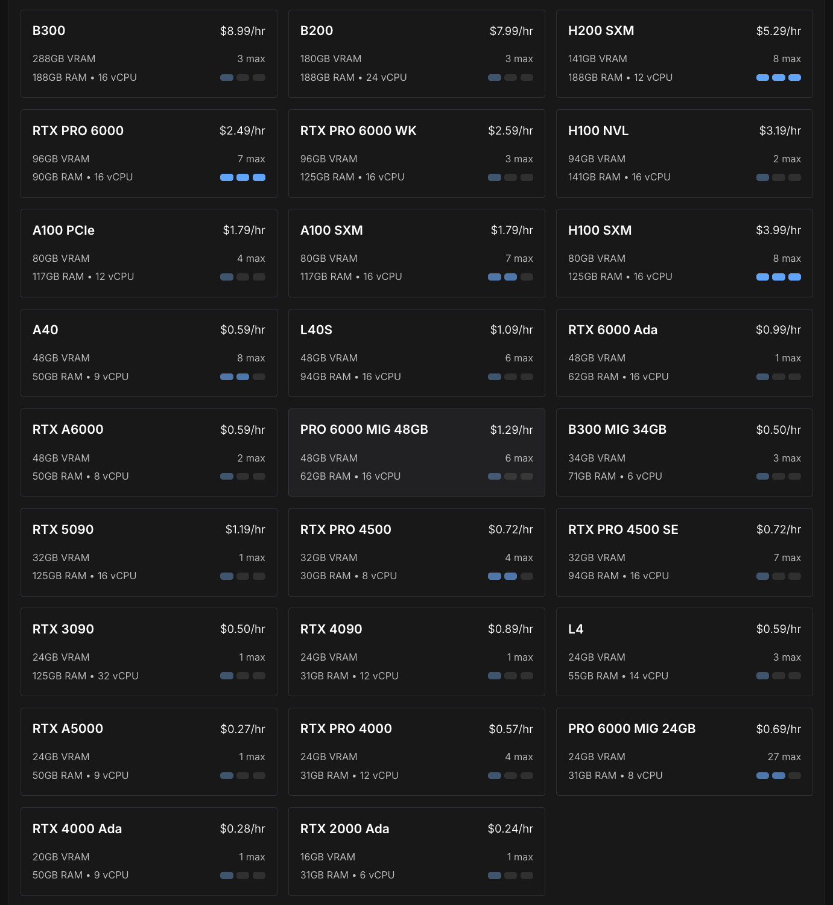
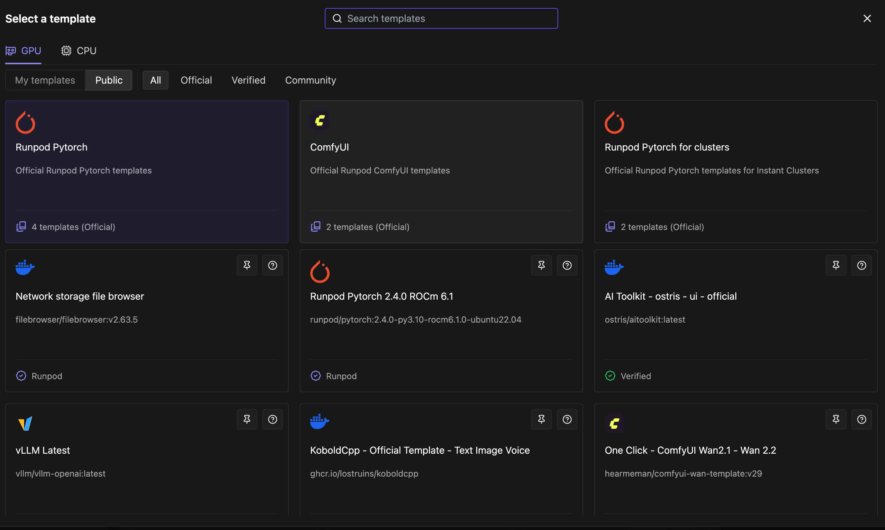
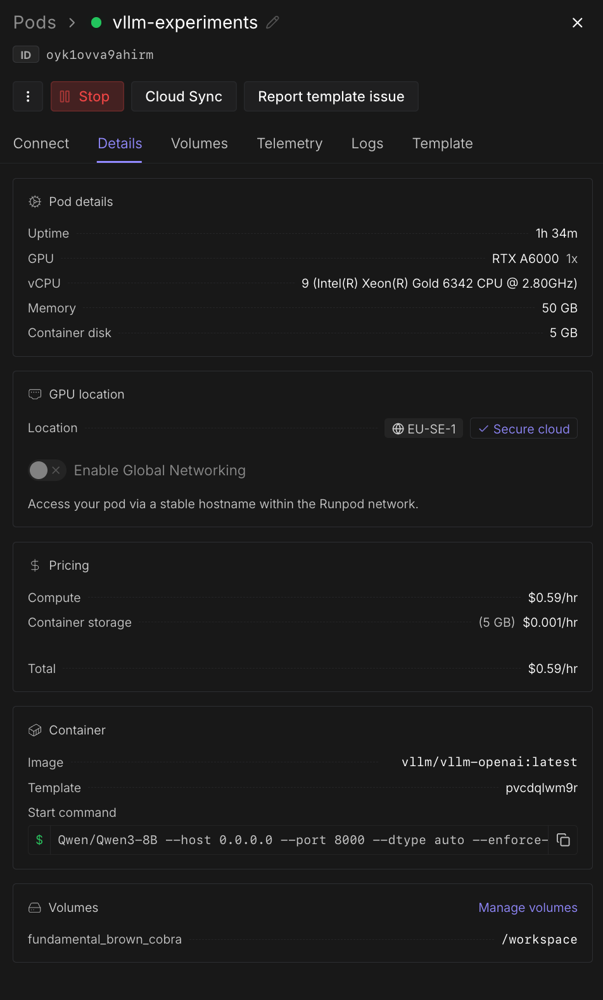
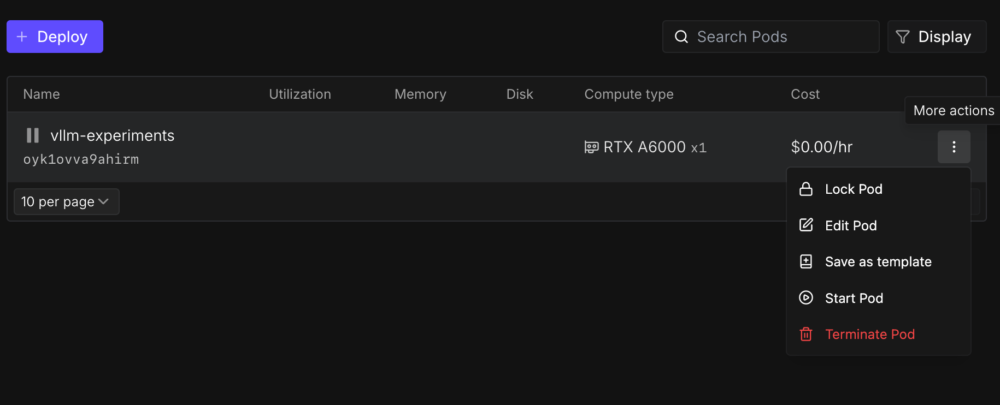

Until recently, I had only used language models through commercial APIs. When I got curious about running an open-weight model myself, my first thought was to buy a maxed out Mac Studio, but spending several thousand dollars just to satisfy my curiosity didn't make much sense, so I rented a cloud GPU instead.

I wanted to see how running inference on a raw GPU compares to using an API, what it costs, and whether it's worth the effort.

## Getting a model running without buying hardware

I used RunPod so I could rent an NVIDIA GPU by the hour without managing a physical machine. I looked at cheaper cards first, including the RTX A5000 and RTX 3090, but availability pushed me to an NVIDIA RTX A6000 with 48 GB of VRAM in RunPod's EU-SE-1 Secure Cloud. In October 2026, that GPU rented for $0.59/hour.



I had already installed RunPod's official skills for <a href="https://pi.dev" target="_blank" rel="noopener">Pi</a>, my coding agent, yet **I deliberately did the first deployment by hand**. I wanted to click through the template and understand the moving parts before handing anything off.

I picked RunPod's `vLLM Latest` template (`vllm/vllm-openai:latest`, which ran vLLM 0.31.0 at the time) and deployed `Qwen/Qwen3-8B` with a 5 GB container disk and a separate volume mounted at `/workspace` for the model cache. If you try this now, pin a specific vLLM version tag rather than `latest`, which changes over time.



Here's the effective launch command from my running pod (with `VLLM_API_KEY` set in the container environment):

```bash
vllm serve Qwen/Qwen3-8B \
  --host 0.0.0.0 \
  --port 8000 \
  --dtype auto \
  --enforce-eager \
  --gpu-memory-utilization 0.95 \
  --max-model-len 8128
```

A couple of template defaults here affect performance: `--enforce-eager` disables CUDA graphs (trading some small-batch decode speed for faster startup), and `--max-model-len 8128` caps context well below Qwen3-8B's native 32K window.

Right after the model loaded, `nvidia-smi` showed about 46 GB of the 48 GB VRAM allocated while GPU compute utilization sat at 0%. That's `--gpu-memory-utilization 0.95` reserving VRAM upfront for model weights and the KV cache. **Allocated GPU memory doesn't mean the card is actively running inference.**

Exposing port 8000 as an HTTP port gives you a <a href="https://docs.runpod.io/pods/configuration/expose-ports" target="_blank" rel="noopener">RunPod proxy URL</a> (`https://<pod-id>-8000.proxy.runpod.net`), with vLLM's OpenAI-compatible API under `/v1`. Setting `VLLM_API_KEY` (or `--api-key`) gates `/v1` requests, though the <a href="https://docs.vllm.ai/en/stable/usage/security/" target="_blank" rel="noopener">vLLM security docs</a> note it doesn't authenticate every route on the server, so don't rely on it alone for a public deployment.

Once the endpoint came up, I hit it from my Mac mini over the HTTPS proxy instead of working inside SSH. Here's the streaming request shape I used:

```bash
curl --no-buffer "${VLLM_BASE_URL%/}/chat/completions" \
  -H "Authorization: Bearer ${VLLM_API_KEY}" \
  -H "Content-Type: application/json" \
  -d '{
    "model": "Qwen/Qwen3-8B",
    "messages": [{"role": "user", "content": "Count upward from 1, separated by spaces."}],
    "max_tokens": 256,
    "temperature": 0,
    "seed": 0,
    "stream": true,
    "stream_options": {"include_usage": true},
    "chat_template_kwargs": {"enable_thinking": false}
  }'
```

`stream_options.include_usage` tells vLLM to include token counts at the end of the stream, and `enable_thinking: false` disables Qwen3's reasoning mode. My first manual non-streaming test returned 224 tokens in about 7.1 seconds; turning on streaming brought the first byte back in about 0.89 seconds (including the proxy round-trip to Sweden).

## One user leaves most of the GPU idle

To figure out what a rented GPU costs per token, you need to know how much work it can handle at once. Once `curl` confirmed the endpoint worked, I had Pi write a small Python script on my Mac mini to measure throughput under load.

On a single request with a short prompt, `Qwen3-8B` decoded at roughly 41 to 42 tokens/s after the first token. That feels snappy, though one request leaves most of the card unused. Here's what happened when I sent one, two, and four requests at the same time:

<style>
.llm-viz{font-family:inherit;}
.llm-viz .t{fill:var(--color-ink,#211f26);font-size:13px;}
.llm-viz .h{fill:var(--color-ink,#211f26);font-size:14px;font-weight:600;}
.llm-viz .m{fill:var(--color-mute,#65636d);font-size:12px;}
.llm-viz .g{stroke:var(--color-rule,#dcdbdd);stroke-width:1;}
.llm-viz .bar{fill:var(--color-accent,#e5484d);}
.llm-viz .line{fill:none;stroke:var(--color-accent,#e5484d);stroke-width:2;stroke-linejoin:round;stroke-linecap:round;}
.llm-viz .dot{fill:var(--color-accent,#e5484d);stroke:var(--color-paper,#fdfcfd);stroke-width:2;}
</style>

<figure>
<div style="display:flex;flex-wrap:wrap;gap:1.5rem;justify-content:center">
<svg class="llm-viz" viewBox="0 0 300 230" role="img" aria-label="Column chart: total output tokens per second rises from 36 with one request at once to 63 with two and 122 with four." style="flex:1 1 260px;max-width:340px;height:auto">
<text class="h" x="0" y="18">Total output (tokens/s)</text>
<line class="g" x1="40" x2="288" y1="186.0" y2="186.0"/>
<text class="m" x="32" y="190.0" text-anchor="end">0</text>
<line class="g" x1="40" x2="288" y1="145.4" y2="145.4"/>
<text class="m" x="32" y="149.4" text-anchor="end">40</text>
<line class="g" x1="40" x2="288" y1="104.9" y2="104.9"/>
<text class="m" x="32" y="108.9" text-anchor="end">80</text>
<line class="g" x1="40" x2="288" y1="64.3" y2="64.3"/>
<text class="m" x="32" y="68.3" text-anchor="end">120</text>
<path class="bar" d="M69.3,186.0V153.4Q69.3,149.4 73.3,149.4H89.3Q93.3,149.4 93.3,153.4V186.0Z"><title>1 at once: 36.1 output tokens/s total (5 requests in 5 batches)</title></path>
<text class="t" x="81.3" y="143.4" text-anchor="middle">36</text>
<text class="m" x="81.3" y="204" text-anchor="middle">1</text>
<path class="bar" d="M152.0,186.0V126.0Q152.0,122.0 156.0,122.0H172.0Q176.0,122.0 176.0,126.0V186.0Z"><title>2 at once: 63.1 output tokens/s total (10 requests in 5 batches)</title></path>
<text class="t" x="164.0" y="116.0" text-anchor="middle">63</text>
<text class="m" x="164.0" y="204" text-anchor="middle">2</text>
<path class="bar" d="M234.7,186.0V66.2Q234.7,62.2 238.7,62.2H254.7Q258.7,62.2 258.7,66.2V186.0Z"><title>4 at once: 122.1 output tokens/s total (20 requests in 5 batches)</title></path>
<text class="t" x="246.7" y="56.2" text-anchor="middle">122</text>
<text class="m" x="246.7" y="204" text-anchor="middle">4</text>
<text class="m" x="164.0" y="224" text-anchor="middle">requests at once</text>
</svg>
<svg class="llm-viz" viewBox="0 0 300 230" role="img" aria-label="Column chart: median time per request rises from 3.5 seconds with one request at once to 3.7 with two and 4.2 with four." style="flex:1 1 260px;max-width:340px;height:auto">
<text class="h" x="0" y="18">Median time per request (s)</text>
<line class="g" x1="40" x2="288" y1="186.0" y2="186.0"/>
<text class="m" x="32" y="190.0" text-anchor="end">0</text>
<line class="g" x1="40" x2="288" y1="157.6" y2="157.6"/>
<text class="m" x="32" y="161.6" text-anchor="end">1</text>
<line class="g" x1="40" x2="288" y1="129.2" y2="129.2"/>
<text class="m" x="32" y="133.2" text-anchor="end">2</text>
<line class="g" x1="40" x2="288" y1="100.8" y2="100.8"/>
<text class="m" x="32" y="104.8" text-anchor="end">3</text>
<line class="g" x1="40" x2="288" y1="72.4" y2="72.4"/>
<text class="m" x="32" y="76.4" text-anchor="end">4</text>
<line class="g" x1="40" x2="288" y1="44.0" y2="44.0"/>
<text class="m" x="32" y="48.0" text-anchor="end">5</text>
<path class="bar" d="M69.3,186.0V89.4Q69.3,85.4 73.3,85.4H89.3Q93.3,85.4 93.3,89.4V186.0Z"><title>1 at once: median 3.54 s per request, median 41.6 tokens/s per request after the first token</title></path>
<text class="t" x="81.3" y="79.4" text-anchor="middle">3.5</text>
<text class="m" x="81.3" y="204" text-anchor="middle">1</text>
<path class="bar" d="M152.0,186.0V84.4Q152.0,80.4 156.0,80.4H172.0Q176.0,80.4 176.0,84.4V186.0Z"><title>2 at once: median 3.72 s per request, median 41.1 tokens/s per request after the first token</title></path>
<text class="t" x="164.0" y="74.4" text-anchor="middle">3.7</text>
<text class="m" x="164.0" y="204" text-anchor="middle">2</text>
<path class="bar" d="M234.7,186.0V69.5Q234.7,65.5 238.7,65.5H254.7Q258.7,65.5 258.7,69.5V186.0Z"><title>4 at once: median 4.24 s per request, median 33.2 tokens/s per request after the first token</title></path>
<text class="t" x="246.7" y="59.5" text-anchor="middle">4.2</text>
<text class="m" x="246.7" y="204" text-anchor="middle">4</text>
<text class="m" x="164.0" y="224" text-anchor="middle">requests at once</text>
</svg>
</div>
<figcaption class="text-sm leading-normal text-mute italic">Measured from my client over RunPod's proxy (small sample of 5 batches per setting, 39 prompt / 128 output tokens). Total output is combined throughput, not single-request speed.</figcaption>
</figure>

At four concurrent requests, combined output jumped from 36.1 to 122.1 tokens/s (3.38x). In exchange, individual requests slowed down by about 20%: median latency went from 3.54 to 4.24 seconds, and per-request decoding dropped from 41.6 to 33.2 tokens/s. I stopped at concurrency 4 even though throughput was still climbing on a 48 GB card, so a tuned server handling heavier traffic could push output higher. Still, **for a single developer sending one prompt at a time, you're paying for far more throughput than you use.**

## What it costs

With a rented GPU, **you pay for time, not tokens**. At $0.59/hour ($14.16/day, or $424.80/month), the meter runs whether the model is generating output or sitting idle. As idle time grows, the effective cost per million output tokens climbs fast:

<figure>
<svg class="llm-viz" viewBox="0 0 440 290" role="img" aria-label="Line chart: projected GPU cost per million output tokens at four requests at once falls from $13.42 at 10% busy time to $1.34 at 100%." style="width:100%;max-width:520px;height:auto;display:block;margin:0 auto">
<text class="h" x="0" y="18">GPU rental per million output tokens</text>
<line class="g" x1="48" x2="416" y1="244.0" y2="244.0"/>
<text class="m" x="40" y="248.0" text-anchor="end">$0</text>
<line class="g" x1="48" x2="416" y1="189.6" y2="189.6"/>
<text class="m" x="40" y="193.6" text-anchor="end">$4</text>
<line class="g" x1="48" x2="416" y1="135.2" y2="135.2"/>
<text class="m" x="40" y="139.2" text-anchor="end">$8</text>
<line class="g" x1="48" x2="416" y1="80.8" y2="80.8"/>
<text class="m" x="40" y="84.8" text-anchor="end">$12</text>
<text class="m" x="48.0" y="262" text-anchor="middle">10%</text>
<text class="m" x="109.3" y="262" text-anchor="middle">25%</text>
<text class="m" x="211.6" y="262" text-anchor="middle">50%</text>
<text class="m" x="313.8" y="262" text-anchor="middle">75%</text>
<text class="m" x="416.0" y="262" text-anchor="middle">100%</text>
<text class="m" x="232.0" y="284" text-anchor="middle">share of rented time spent serving requests</text>
<path class="line" d="M48.0,61.4 L52.1,78.0 L56.2,91.9 L60.3,103.6 L64.4,113.6 L68.4,122.3 L72.5,129.9 L76.6,136.6 L80.7,142.6 L84.8,147.9 L88.9,152.7 L93.0,157.1 L97.1,161.0 L101.2,164.6 L105.2,167.9 L109.3,171.0 L113.4,173.8 L117.5,176.4 L121.6,178.8 L125.7,181.0 L129.8,183.1 L133.9,185.1 L138.0,186.9 L142.0,188.7 L146.1,190.3 L150.2,191.8 L154.3,193.3 L158.4,194.7 L162.5,196.0 L166.6,197.2 L170.7,198.4 L174.8,199.5 L178.8,200.5 L182.9,201.5 L187.0,202.5 L191.1,203.4 L195.2,204.3 L199.3,205.2 L203.4,206.0 L207.5,206.7 L211.6,207.5 L215.6,208.2 L219.7,208.9 L223.8,209.6 L227.9,210.2 L232.0,210.8 L236.1,211.4 L240.2,212.0 L244.3,212.5 L248.4,213.1 L252.4,213.6 L256.5,214.1 L260.6,214.6 L264.7,215.0 L268.8,215.5 L272.9,215.9 L277.0,216.3 L281.1,216.8 L285.2,217.2 L289.2,217.5 L293.3,217.9 L297.4,218.3 L301.5,218.6 L305.6,219.0 L309.7,219.3 L313.8,219.7 L317.9,220.0 L322.0,220.3 L326.0,220.6 L330.1,220.9 L334.2,221.2 L338.3,221.5 L342.4,221.7 L346.5,222.0 L350.6,222.3 L354.7,222.5 L358.8,222.8 L362.8,223.0 L366.9,223.3 L371.0,223.5 L375.1,223.7 L379.2,223.9 L383.3,224.2 L387.4,224.4 L391.5,224.6 L395.6,224.8 L399.6,225.0 L403.7,225.2 L407.8,225.4 L411.9,225.6 L416.0,225.7"/>
<circle class="dot" cx="48.0" cy="61.4" r="5"><title>10% busy: $13.42 per million output tokens</title></circle>
<text class="t" x="57.0" y="51.4" text-anchor="start">$13.42</text>
<circle class="dot" cx="109.3" cy="171.0" r="5"><title>25% busy: $5.37 per million output tokens</title></circle>
<text class="t" x="118.3" y="161.0" text-anchor="start">$5.37</text>
<circle class="dot" cx="211.6" cy="207.5" r="5"><title>50% busy: $2.68 per million output tokens</title></circle>
<text class="t" x="220.6" y="197.5" text-anchor="start">$2.68</text>
<circle class="dot" cx="416.0" cy="225.7" r="5"><title>100% busy: $1.34 per million output tokens</title></circle>
<text class="t" x="407.0" y="215.7" text-anchor="end">$1.34</text>
</svg>
<figcaption class="text-sm leading-normal text-mute italic">Projected GPU rental at $0.59/hour assuming the concurrency-4 rate during busy time and idle time otherwise. Estimates cover GPU time only, not my total session spend.</figcaption>
</figure>

To make a rented GPU pay for itself against commercial APIs, **you have to keep the card busy**. Comparing the same 39-input / 128-output request against October 2026 standard API list prices:

- **Low-cost APIs ($0.10/M input, $0.50/M output, such as GPT-6 Luna or Claude Haiku 5.5):** at my tested concurrency-4 rate and 100% busy time, the rented A6000 is still roughly 2.5x more expensive per request.
- **Mid-tier APIs ($2.00/M input, $10.00/M output, such as GPT-6.1 Sol or Claude Sonnet 5.5):** breaking even on the $0.59/hour GPU alone takes roughly 430 of these short requests every hour (over 10,000 a day): about 13% busy time at concurrency 4, or 43% running one request at a time.

Higher concurrency or input-heavy coding prompts would shift those numbers, and this math only compares raw token counts, not model quality. Reaching break-even against mid-tier pricing still leaves you with an 8B open-weight model rather than a frontier model from Anthropic, OpenAI, or Google.

Across my full 69-request benchmark run (about 167 seconds, including warm-ups and separate output and prompt sweeps), GPU time came to roughly $0.027. The pod stayed up for 94 minutes across setup and testing, which works out to roughly $0.93 at $0.59/hour plus $0.001/hour for the container disk (before any charge for the separate `/workspace` volume).



When you're done, stopping a RunPod pod halts the hourly GPU charge, but **storage billing continues until you terminate the pod**. If you attached a separate network or global volume at `/workspace`, delete that volume too, since terminating a pod only detaches it.



## Is it worth the effort?

As a way to learn without dropping thousands of dollars on a Mac Studio, yes. Getting a model running on RunPod only took a few minutes, and the main lessons still apply to local hardware. You see firsthand how model weights and the KV cache consume memory, what single-user speed feels like on an 8B model, and how much capacity sits idle when only one person is sending prompts. **Spending a dollar on a rental lets you test those tradeoffs before buying hardware.**

What I didn't test is the bigger question for day-to-day work: is using open-weight models actually a good experience, and can they compete with frontier models from the big labs? Renting a GPU is great for learning how inference serving works, though if model quality is what you want to evaluate, a hosted router like <a href="https://openrouter.ai/" target="_blank" rel="noopener">OpenRouter</a> or <a href="https://vercel.com/ai-gateway" target="_blank" rel="noopener">Vercel AI Gateway</a> is a better way to try open-weight models on real coding tasks without managing a server at all.

If you've been eyeing local hardware just to experiment with open-weight models, I suggest renting a GPU for an hour or two first. You'll learn how inference serving behaves for about a dollar before deciding whether to buy anything.
